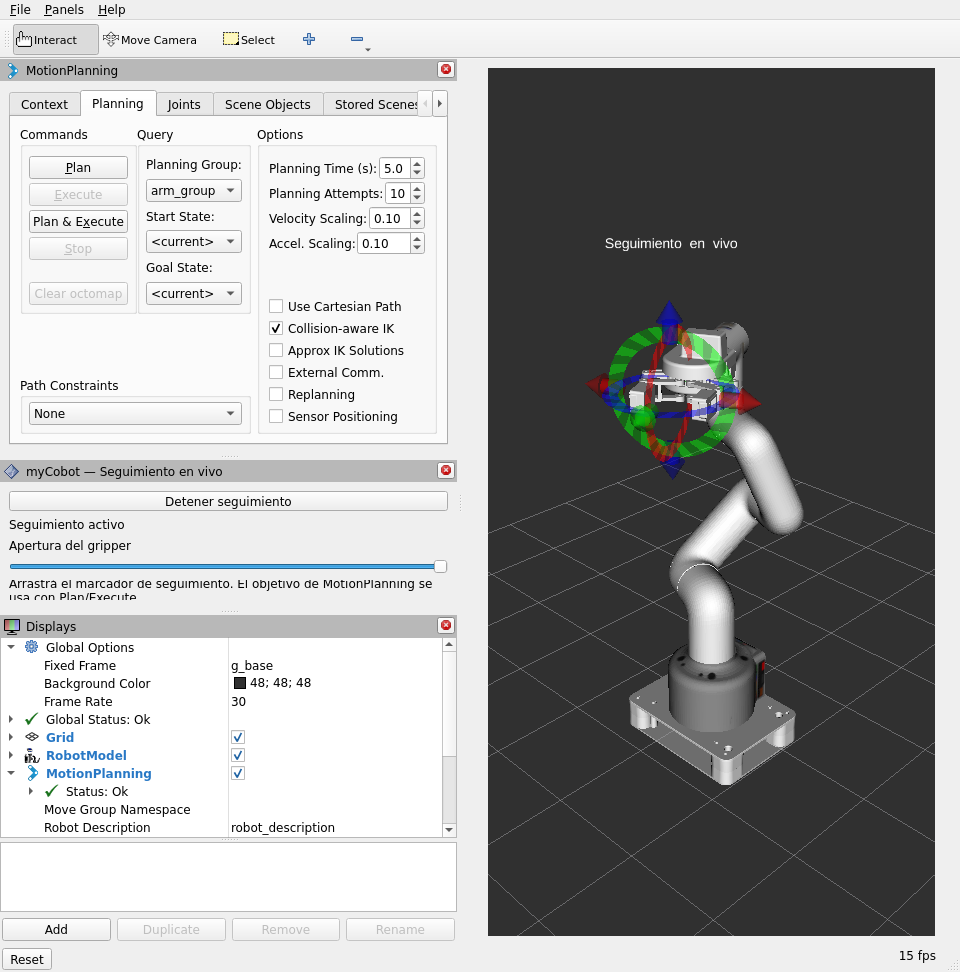

# myCobot RViz — Real & Simulated Arm Control

Control a myCobot 280 M5 robotic arm in RViz using ROS 2 and MoveIt 2, with
Gazebo simulation, interactive tracking, and optional USB hardware control.
Runs with Docker.


## Requirements

- Linux x86_64 with X11 or XWayland.
- [Docker Engine](https://docs.docker.com/engine/install/ubuntu/) and
  [Docker Compose v2](https://docs.docker.com/compose/install/linux/).
- At least 10 GB of free disk space for the image and build files.

## Run the simulation

From the repository directory, run these commands on the host:

```bash
export XAUTHORITY="${XAUTHORITY:-$HOME/.Xauthority}"
export MYCOBOT_X11_HOSTNAME="${XAUTHLOCALHOSTNAME:-$(hostname)}"
test -f "$XAUTHORITY" && test -n "$DISPLAY"
docker compose build
docker compose up
```

The display check must succeed. If it fails, set `XAUTHORITY` to your session's
actual authorization file. Repeat the exports in each new terminal.

Gazebo and RViz start with the arm and adaptive gripper. USB access and physical
motion are disabled. Rebuild the image after changing source code.

In RViz:

- Select `arm_group`, set **Start State → <current>**, then **Plan → Execute**.
- Select `gripper_group` and use the `open` or `closed` goal to operate the gripper.
- Click **Activar seguimiento** to plan and execute automatically while dragging
  the marker. Use the slider for the gripper and **Detener seguimiento** to stop.



Stop tracking, press **Ctrl+C**, then run:

```bash
docker compose down
```

## NVIDIA GPU (optional)

With the [NVIDIA Container Toolkit](https://docs.nvidia.com/datacenter/cloud-native/container-toolkit/latest/install-guide.html)
installed, replace `docker compose up` with:

```bash
docker compose -f compose.yaml -f compose.nvidia.yaml up
```

The default configuration uses CPU rendering. Use the same `-f` options for `down`.

## Physical robot (optional)

Stop the simulation session, then enable USB with physical motion blocked:

```bash
export MYCOBOT_PORT=/dev/ttyACM0
docker compose -f compose.yaml -f compose.hardware.yaml up
```

Change `MYCOBOT_PORT` if your device uses another port. Inside the container,
it is always mapped to `/dev/ttyACM0`. See the
[hardware guide](mycobot_280/mycobot_280_hardware/README.md) for calibration and
stop verification; this image's workspace is `/opt/mycobot_ws`.

After verifying calibration and stopping on your device, stop the previous
session and explicitly enable motion:

```bash
docker compose -f compose.yaml -f compose.hardware.yaml down
docker compose -f compose.yaml -f compose.hardware.yaml run --rm mycobot \
  ros2 launch mycobot_280_hardware control.launch.py \
  adaptive_gripper:=true port:=/dev/ttyACM0 \
  allow_motion:=true gripper_stop_confirmed:=true
```

`gripper_stop_confirmed` is an operator confirmation, not an automatic test.
With tracking stopped, select **Manipulador físico** in RViz and confirm the
destination. Replan after switching destinations. Only one process may own USB.

## Tests

```bash
docker run --rm mycobot-rviz-real-and-sim:humble bash -c \
  'cd /opt/mycobot_ws && python3 -m pytest -q src/mycobot/mycobot_280'
```

Software tests do not establish physical accuracy or safe operation under load.

## Credits

Based on [Elephant Robotics mycobot_ros2](https://github.com/elephantrobotics/mycobot_ros2).
Original package licenses and attribution are preserved.
