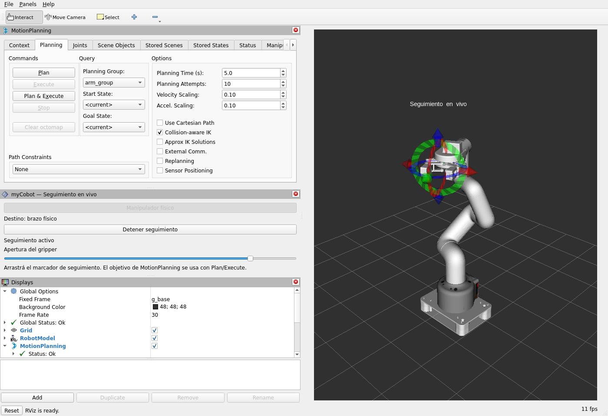
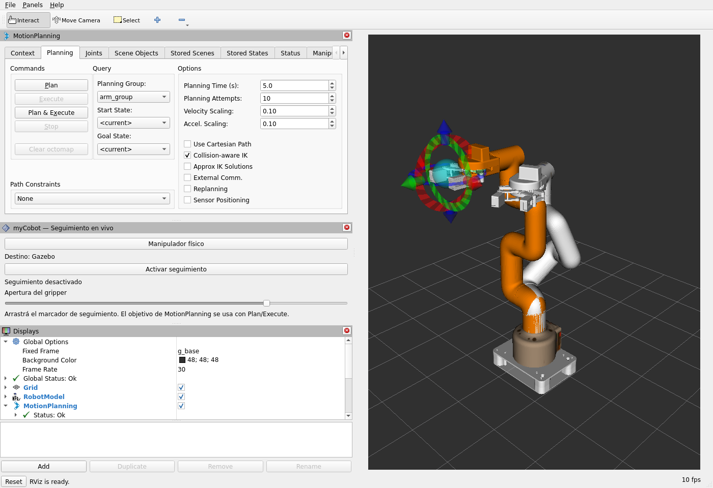

# Validación del selector Gazebo / manipulador físico en un único RViz

Fecha: 2026-10-23. Trabajo en la sesión principal, sin subagentes ni commits.
Diseño aprobado: `docs/superpowers/specs/2026-10-23-unified-rviz-physical-control-design.md`.

## Alcance y límites

La selección es exclusiva. El mismo panel y las mismas acciones públicas sirven
para simulación o hardware; no se replican movimientos en ambos destinos.
El seguimiento y las trayectorias se excluyen también en el controlador físico.
Los estados seleccionados alimentan un único `/joint_states` y un único emisor
canónico de TF. Cambiar destino invalida los planes y reinicia MotionPlanning.

**No se conectó ni movió un manipulador real.** Las pruebas del transporte físico
usan `test/fake_hardware.py`, que nunca abre un puerto serie. No validan la
calibración, tiempos, velocidades reales, agarre, firmware ni distancia de parada.

## Compilación y pruebas funcionales

- `colcon build --symlink-install --packages-up-to mycobot_280_hardware`:
  siete paquetes compilados, incluido `mycobot_280_control_interfaces`.
- ROS_DOMAIN_ID=49, `python3 -m pytest -q -m "not linter" -p no:cacheprovider`:
  **123 pruebas funcionales aprobadas**, tres linters heredados excluidos.
  Se conserva una advertencia de la dependencia xacro.
- ROS_DOMAIN_ID=48, `QT_QPA_PLATFORM=offscreen ctest --output-on-failure` en
  `build/mycobot_280_live_control`: **2/2 aprobadas**.
- `ruff check --select F,E9` sobre los nuevos módulos: aprobado.
- `git diff --check`: aprobado.

Las pruebas de Qt y Python deben usar dominios separados: ambos crean
publicadores de estado del selector. Una ejecución concurrente en el mismo
DOMINIO produjo interferencia entre fixtures; la ejecución aislada pasa.

Regresiones verificadas primero en rojo y luego en verde:

- Permiso desactivado al inicio y sin posiciones iniciales enviadas al USB.
- Sesión, secuencia, antigüedad, límites y finitud de consignas; rechazo de
  paquetes antiguos y ausencia de rearmado automático.
- Comprobación de permiso en el instante de escritura USB, no solo al aceptar
  una acción; exclusión de trayectorias mientras sigue en vivo.
- Parada del firmware verificada con datos no móviles y ángulos válidos;
  parada desconocida enclava el fallo. La pinza conserva su parada específica.
- Watchdog físico activo incluso si el reloj ROS se pausa; temporizadores
  explícitos con `STEADY_TIME` y plazos monotónicos.
- Límite de incremento, adelanto máximo respecto de la medición y detección de
  falta de progreso del robot, aunque sigan llegando consignas.
- Planes invalidados al cambiar y al volver al destino anterior; firmas
  semánticas estables al serializar/deserializar ROS. El padding CDR no sirve
  como identidad del plan.
- Extremo calibrado de la pinza 100 → 0.15 exacto; se evita redondearlo a
  0.15000000000000002 sin ocultar lecturas físicas fuera del rango del modelo.
- Estados de hardware retrasados no sobrescriben el acuse de cambio: ID de
  arranque del controlador y contador de estado confirmados en la respuesta.
- Peticiones antiguas de deselección no afectan una sesión posterior.
- Fallos del transporte de acciones revocan la sesión física sin redirigir a
  Gazebo; objetivos ExecuteTrajectory no finitos se rechazan sin excepción.
- Botón asíncrono, selección solo confirmada y rechazo/estado pendiente en Qt;
  sigue inhabilitado para cambiar destino durante seguimiento.
- Namespace opcional de Gazebo y conservación de nombres del lanzamiento anterior.

## Integración con Gazebo Classic y USB falso

Instancia aislada: dominio 47, `GAZEBO_MASTER_URI=http://127.0.0.1:11367`.
Lanzamiento con `launch_driver:=false gui:=false use_rviz:=false`, seguido del
emulador en namespace `/physical`. El emulador aplica las mismas restricciones
iniciales de velocidad configurada (máximo 10 de firmware) y confirma paradas.

Ejecutar `test/unified_control_integration.py` comprueba:

1. Cambio de destino rechazado durante una trayectoria y cancelación propagada
   al controlador de Gazebo.
2. Pausar Gazebo no se convierte en estados frescos por republicación; las
   ejecuciones con esas mediciones caducadas se rechazan.
3. Plan & Execute, Plan y Execute separados, y seguimiento de brazo/pinza en
   Gazebo mediante el nuevo coordinador; el USB falso permanece inmóvil.
4. Selección física basada en sus posiciones medidas; rechazo del plan anterior
   de Gazebo.
5. Plan & Execute y ejecución separada en el USB falso; Gazebo conserva postura.
6. Seguimiento del brazo y pinza del USB falso, error cinemático del objetivo
   comprobado con FK; bloqueo de cambio de destino y de acciones de trayectoria
   tanto públicas como directamente sobre el driver durante seguimiento.
7. Cancelación propagada a la acción de pinza física y ejecución de una nueva
   trayectoria de pinza después de detener seguimiento.
8. Pérdida del heartbeat revoca la sesión, conserva visible el destino físico
   en fallo y no conmuta al simulador. Recuperar heartbeat no rearma el hardware.

Registro de la ejecución final: `/tmp/unified-complete-runtime.log` dentro del
contenedor. El error FK es de un ejemplo sintético y no expresa precisión del
myCobot real.

## Verificación visual

Se abrió un RViz de prueba en dominio 47 y se cambió el destino dos veces.
MotionPlanning reinicializó sus estados y su conexión; el estado global quedó
OK. El mismo panel muestra «Destino: brazo físico», el botón seleccionado, el
marcador de seguimiento activo y el deslizador de pinza, sin objetivo naranja
superpuesto. La captura corresponde exclusivamente a hardware falso:

## Preparación del equipo real

Al inspeccionar este equipo no había `/dev/ttyACM*` ni `/dev/ttyUSB*` en Ubuntu.
El contenedor `ros2-humble` tiene `HostConfig.Devices=[]` y no es privilegiado.
Será necesario exponer el puerto real con `--device` en un contenedor preparado;
`docker exec` no modifica el acceso a dispositivos. Los comandos que conservan
el contenedor actual y sus dependencias están en el README de hardware.

El lanzamiento integrado conserva `allow_motion:=false` y
`gripper_stop_confirmed:=false` por defecto. No prueba automáticamente la parada
específica de la pinza, no calibra, no hace cero y no libera servos. El operador
necesita verificar el equipo y habilitar esos parámetros antes de seleccionarlo.
El seguimiento además verifica el modo de firmware «última consigna» antes de
activar la salida continua. Una desconexión USB puede impedir entregar la parada;
el software no sustituye una parada física independiente.

## Estado dejado al usuario

Se cerraron los procesos de prueba del dominio 47, incluido el USB falso.
En dominio 42 / maestro 11345 queda un único RViz, un gzserver y un gzclient,
con el lanzamiento integrado y una postura doblada preparada exclusivamente en
Gazebo. Seguimiento desactivado, destino Gazebo y `allow_motion=false` en el
controlador físico; `require_session=true` confirmado por el servicio de parámetros.
La acción pública `/move_action` tiene un único servidor (`/mycobot_control`)
y `/joint_states` un único publicador. Registro: `/tmp/unified-user42.log`.

## Actualización: detección del USB físico

Después de conectar el equipo, Ubuntu creó `/dev/ttyACM0` (USB
`1a86:55d4`, enlace `usb-1a86_USB_Single_Serial_5A49068291-if00`). El contenedor
original seguía sin ese dispositivo. Se conservó `ros2-humble` y se creó la imagen
local `mycobot-humble:usb-20261023` con sus dependencias, y el contenedor
`mycobot-hardware`, con los mismos volúmenes y `--device=/dev/ttyACM0:/dev/ttyACM0`.

Lecturas reales, exclusivamente con `get_angles()` y `get_gripper_value(type=1)`:

- Muestras 1–2: `[-0.26, -0.52, -0.43, -1.05, -0.52, -0.96]` grados.
- Muestra 3: `[-0.26, -0.52, -0.43, -1.05, -0.52, -0.87]` grados.
- Gripper: valor `15` en las tres muestras, equivalente nominal a `-0.6065 rad`.

Esto confirma comunicación con el brazo y la pinza. No valida ejecución ni
parada: **no se enviaron órdenes de movimiento**. La posición medida de la pinza
está fuera de `[-0.5, 0.15]` del modelo compatible, se conserva sin modificar y
bloquea ejecución. No se ensancharon límites ni se abrió la pinza automáticamente.

Se mejoró el diagnóstico del controlador para distinguir USB ausente, fallo
enclavado y modo de solo lectura; el panel muestra conexión USB y mediciones
fuera de límites. Regresión rojo→verde y suite funcional actualizada:
**124 aprobadas, tres linters heredados excluidos**.

La sesión gráfica se trasladó al contenedor `mycobot-hardware`, conservando
`allow_motion=false` y `gripper_stop_confirmed=false`. Registro de esa sesión:
`/tmp/mycobot-usb-session.log` en el contenedor nuevo. El contenedor anterior
permanece conservado, sin su sesión ROS gráfica activa.

Tras verificar la comunicación, se conservó el nombre habitual `ros2-humble`
para el contenedor con USB (creado inicialmente como `mycobot-hardware`). El
original quedó como `ros2-humble-sin-usb-20261023`, con la sesión ROS y su daemon
cerrados. No se perdieron ni movieron los volúmenes del repositorio/workspace.
Verificación ROS real: `connected=true`, `selected=false`, `fault=false`, siete
posiciones recibidas y panel «Destino: Gazebo · Brazo USB conectado · solo
lectura · pinza=-0.6065 fuera del rango [-0.5, 0.15]».

## Seguimiento: calibración y parada físicas

Tras confirmar el operador que la pinza estaba cerrada, se calibró el cierre
estable a valor 12 y se comprobó una pequeña apertura supervisada. El stop de
SDK por torque no pasó la prueba dinámica; la estrategia de mantener la posición
medida sí confirmó parada dentro del plazo del controlador. Se implementó
`gripper_stop_strategy=hold_position` y se verificó selección/deselección física
sin mandar trayectorias a los seis ejes. Suite actual: 132 pruebas funcionales.
Detalle, alcance y evidencia: [physical-gripper-control](2026-10-23-physical-gripper-control.md).
La sesión se reinició mediante un único `control.launch.py`, con permiso de
movimiento y confirmación de parada habilitados; inicia con destino Gazebo.
